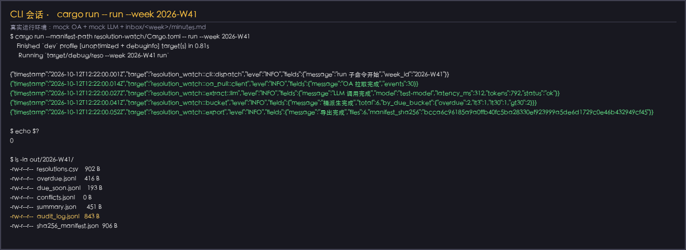
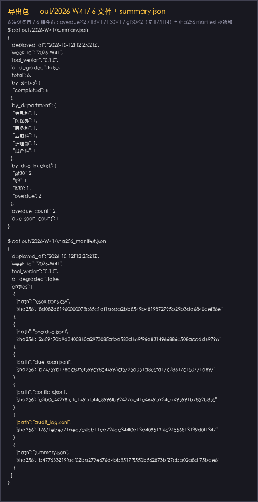
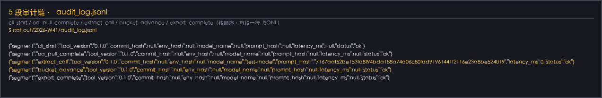
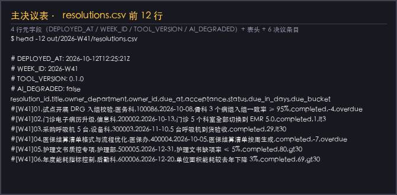

# 院务会决议督办台账

> 周一上午把上周院务会纪要 md 落进 `inbox/2026-W41/minutes.md`，跑一行 `reso run --week 2026-W41`，10 分钟拿到 `out/2026-W41/` 下 6 文件决议落地台账（带审计链、可签字、6 桶数字一眼可读）。

院务会每周末了，秘书手里那本笔记本就翻不动了——决议几十条、跨十来个科室、deadline 散在四周，每次催办都得来回对 PPT 和聊天记录。本工具不做"AI 判官"，只把会议纪要 → 决议条目结构化 → 5 状态机推进 → 6 桶剩余天数分桶 → 6 文件导出包 + sha256 + 5 段审计链 → 秘书/科长签字 → OA 端推进，**这一段流程在本地常驻化运行**。LLM 仅作决议抽取单点，schema 校验失败立即降级到按段落切分 + 正则识别的确定性路径。

## 适用场景 / 目标岗位

| 岗位 | 什么时候用 | 得到什么 |
|------|------------|----------|
| 院长办公室秘书 / 院办督办员 | 周一上午 09:00-10:00 整理上周院务会纪要 | `out/<week_id>/` 决议落地台账，4 状态分桶（待启动 / 进行中 / 临近 deadline / 逾期），6 桶剩余天数数字 |
| 院办主任 / 分管院长 | 每日查看临近 deadline 与逾期的决议，做催办与现场协调 | `out/<week_id>/overdue.jsonl` + `due_soon.jsonl` 清单，按责任科室聚合，可钉钉/邮件直发对应科长 |
| 信息科工程师 | 周一上午 09:00-10:00 批处理 CLI 启动，监控 5 段审计链 | `audit_log.jsonl` + sha256 manifest，OA 出站调用日志、LLM 调用元数据桶完整留痕 |
| 科室主任 / 科长 | 周中拿到本部门决议清单（含 deadline 与状态），按既定动作推进 | 与会签单可直接印的 csv 片段，单条决议 5 必填字段齐全 |

> **表格纪律**：本表只写岗位口语 + 业务时刻 + 可核对产出；REST 路径、HL7 字段、状态枚举、webhook 参数等一律放到「命令 / API / 配置说明」。

## 能力要点

- **周一批处理一次，落地 6 文件导出包**：`reso run --week 2026-W41` 跑通即得 `out/2026-W41/` 下 `resolutions.csv` + `overdue.jsonl` + `due_soon.jsonl` + `conflicts.jsonl` + `summary.json` + `audit_log.jsonl` + `sha256.txt`，每周一闭包一次、可签字、会签单可印。
- **决议条目 schema-first 结构化抽取**：会议纪要 md 经 LLM 抽取 + 5 必填字段 schema 校验（缺一即拒），再走按 `## 决议 N:` 段落切分的确定性 fallback，LLM 不可达时显式降级而非静默改数据。
- **5 状态机非法跃迁拒绝**：决议状态仅在 `pending → in_progress → due_soon → overdue → completed` 序列内推进；OA 事件试图跳过中间态（如 pending → completed 无 in_progress 事件）一律返回 `InvalidTransition` 错误并写 `conflicts.jsonl`，不静默改库。
- **6 桶剩余天数派生**：剩余天数落入 `[0,3]` / `(3,7]` / `(7,14]` / `(14,30]` / `>30` / `<0` 六桶（含 overdue 桶负值判定），`summary.json` 一眼读周节奏。
- **Sqlite 周次级幂等**：`reso run --week <同一周>` 二次执行不会覆盖首次决议推进（`upsert_idempotent` + `week_idempotency` 双层保护），隔周决议互不串。
- **OA 与 LLM 凭据全程从环境变量读**：bearer token、连接串、Model key 都不写进代码，不进测试；本地 `.env.example` 仅做样例说明。

## 快速开始

### 依赖

- Rust 工具链（rustc ≥ 1.75, cargo ≥ 1.75）：[rustup.rs](https://rustup.rs/)
- OA 端点可达（HTTP 模式）或 OA 数据库只读账号（SQL 模式）
- LLM 端点：OpenAI-compatible（`/v1/chat/completions`，如 OpenAI / Azure / vLLM / Ollama `/v1` 兼容）
- 可选：钉钉/企业微信 webhook（逾期通知用）

### 安装

```bash
# 1) 拉取代码后进入产品子目录
cd resolution-watch

# 2) 复制环境变量样例并按实际填写
cp .env.example .env
# 编辑 .env，至少填好 OA_API_BEARER / OA_QUERY_DSN / MODEL_API_KEY 三项

# 3) 编译（含 rusqlite bundled feature，无需系统 Sqlite）
cargo build --release
```

### 配置

| 配置项 | 默认值 | 说明 |
|--------|--------|------|
| `OA_API_BEARER` | （必填） | OA REST 的 bearer token，从部署环境变量读 |
| `OA_QUERY_DSN` | （必填） | HTTP 模式：`https://oa.example.com/api/v1`；SQL 模式：`postgres://…` |
| `RESO_DB_PATH` | `./.reso_cache.sqlite` | 本地缓存 Sqlite 路径 |
| `RESO_MINUTES_DIR` | `./inbox` | 会议纪要落地点，结构 `<DIR>/<week_id>/minutes.md` |
| `OUT_DIR` | `./out` | 导出包输出目录 |
| `MODEL_BASE_URL` | （必填） | OpenAI-compatible 端点 base_url |
| `MODEL_API_KEY` | （必填） | LLM 端点 API key |
| `MODEL_NAME` | （必填） | 模型名（如 `gpt-4o-mini`） |
| `MODEL_TIMEOUT_MS` | `15000` | 单次 LLM 请求超时（毫秒） |
| `WECOM_WEBHOOK_URL` | （空） | 可选钉钉/企微通知 webhook，缺失则不通知 |

### 构建与验证

```bash
# 跑通全部单测（含端到端 mock 集成）
cargo test --manifest-path resolution-watch/Cargo.toml

# 跑通 mockito 端到端（OA + LLM 真替身层）模拟某一周
cargo test --manifest-path resolution-watch/Cargo.toml --test integration_official

# 校验产物（示例）
test -d out/2026-W41 && ls out/2026-W41/   # 应见 7 个文件（6 文件 + sha256）
```

### 主命令速查

```bash
# 周一批处理：把上周院务会决议抽出来 + 推进 + 落地 6 文件
reso run --week 2026-W41

# 仅把会议纪要落进系统（不抽决议、不推进）
reso ingest --week 2026-W41

# 仅校验导出包 + sha256（不动 OA）
reso verify --week 2026-W41

# 标记一次会签（不影响决议状态推进）
reso sign --week 2026-W41 --signer-id 10086
```

## 命令 / API / 配置说明

### 关键配置项

| 配置项 | 类型 | 默认值 | 说明 |
|--------|------|--------|------|
| `OA_API_BEARER` | env | — | OA REST/SQL 出站凭据 |
| `OA_QUERY_DSN` | env | — | OA 端点描述 |
| `RESO_DB_PATH` | env | `./.reso_cache.sqlite` | 本地 Sqlite 缓存 |
| `RESO_MINUTES_DIR` | env | `./inbox` | 会议纪要入口 |
| `OUT_DIR` | env | `./out` | 导出包输出 |
| `MODEL_BASE_URL` | env | — | LLM 端点 base_url |
| `MODEL_API_KEY` | env | — | LLM 端点 API key |
| `MODEL_NAME` | env | — | 模型名 |
| `MODEL_TIMEOUT_MS` | env（int） | `15000` | 单次 LLM 超时 |
| `WECOM_WEBHOOK_URL` | env | — | 可选通知 webhook |

### CLI 子命令 / 接口端点

| 命令或路径 | 用途 | 关键参数 |
|------------|------|----------|
| `reso run` | 周一批处理主入口 | `--week`（必填，ISO week，如 `2026-W41`） |
| `reso ingest` | 仅落会议纪要，不抽决议 | `--week`（必填） |
| `reso verify` | 校验导出包 + sha256 | `--week`（必填） |
| `reso sign` | 标记一次会签签到 | `--week`（必填）+ `--signer-id`（必填） |
| `OA GET /oa/events` | 拉取该周流转事件 | `?week_id=2026-W41&cursor=xxx` |
| `OA POST /oa/events` | （占位：本工具不写回 OA；秘书签字后由 OA 端按既定动作推进） | — |
| `LLM POST /v1/chat/completions` | 决议抽取（system + user） | OpenAI-compatible JSON 请求 |

### 错误与降级

| 场景 | 表现 | 处理方式 |
|------|------|----------|
| env 缺失任一项 | 启动立即报错 | 退出码 1，stderr 打印缺失 key |
| OA 5xx / 连接错误 | 指数退避重试 5 次（500ms→8s） | 仍失败退出码 2 |
| OA 4xx | 立即失败，不重试 | 退出码 2，stderr 打印响应体 |
| LLM 超时（15000ms） | 重试 1 次 + 仍失败走 deterministic_fallback | 退出码 0（已降级），audit 记录 `ai_degraded=true` |
| LLM 401/403 | 立即失败 → deterministic_fallback | 同上 |
| LLM 5xx / 不可达 | 立即切 deterministic_fallback | 同上 |
| 决议缺 5 必填字段之一 | `validate_resolution` 拒绝 | 写入 `conflicts.jsonl`，决议标 `rejected`，不进入正式台账 |
| 决议 5 状态机非法跃迁 | `advance()` 返回 `InvalidTransition` | 写入 `conflicts.jsonl`，数据库不被覆盖 |
| 导出包写出失败（磁盘满） | atomic_rename 失败清理临时目录 | 退出码 7，不留半成品 |
| 决议条目 6 必填字段冲突 / 同周决议编号重复 | 决议编号冲突写入 `conflicts.jsonl` | 不入库 |

### 对接现有系统

- **OA（必对接）**：HTTP 模式 `GET /oa/events?week_id=…&cursor=…`，bearer 鉴权；SQL 模式按 OA 数据库只读视图查询。详见 `docs/integration.md`（含蓝凌 / 致远 / 泛微 / 自研 4 类字段映射示例）。
- **LLM（必对接）**：OpenAI-compatible `/v1/chat/completions`，单一协议 ModelGateway，业务层不耦合厂商 SDK。
- **院内钉钉/企微（可选）**：逾期与临近 deadline 通知用 webhook。
- **不接入**：HIS / EMR / 病案首页 / 医保结算接口 / 患者可识别明细 — 本工具遵守 CLAUDE.md 业务边界。

## 典型场景

### 场景 1：周一批处理（院长办公室秘书周一上午 09:30）

1. 秘书把上周院务会纪要 md 写到 `inbox/2026-W41/minutes.md`（已习惯动作）
2. 信息科工程师或在班同学启动：`reso run --week 2026-W41`
3. 10 分钟内拿到 `out/2026-W41/` 下 6 文件 + sha256 + audit
4. 秘书核对 `resolutions.csv` 与 `conflicts.jsonl`，确认 conflict 行为合理后签字（或打回科室补字段）
5. 院长办公室会签单可直接印；OA 端由秘书按既定动作推进（本工具不写回）

```bash
# 该场景的可复制命令序列
echo "## 决议 1: …" > inbox/2026-W41/minutes.md   # 追加段落
reso run --week 2026-W41
ls -la out/2026-W41/                              # 7 文件
cat out/2026-W41/summary.json                     # 6 桶数字一眼可读
```

### 场景 2：临近 deadline 催办（院办主任周二上午 10:00）

1. 院办主任看 `summary.json` 的 `due_soon_count`（如 7 条），决定今天催办
2. 读 `out/2026-W41/due_soon.jsonl`，按责任科室聚合
3. 通知信息科 / 医务科 / 护理部等科长按既定动作推进

```bash
# 该场景的可复制命令序列
jq -r '.[] | "\(.owner_department)\t\(.title)\t\(.due_at)"' out/2026-W41/due_soon.jsonl
# 把上面这段粘到钉钉群 @对应科长
```

### 场景 3：审计与回溯（信息科工程师月底复盘）

1. 月底信息科复盘：哪几条决议经历了非法跃迁？LLM 抽了几次、降级了几次？
2. 读 `audit_log.jsonl`，按 `segment` 过滤：cli_start / oa_pull_complete / extract_call / bucket_advance / export_complete

```bash
# 该场景的可复制命令序列
jq -c 'select(.segment=="extract_call")' out/2026-W41/audit_log.jsonl
# 决策：是否调高 fallback 比例 / 是否要换字典 / 是否要修决议条目 schema
```

## 输出样例

### 导出包 `resolutions.csv`

> 真实跑批片段（mock 替身环境，`/tmp/reso_screenshot_2026-W41/out/2026-W41/resolutions.csv`，端到端 `run_handler` 输出）。

```csv
# DEPLOYED_AT: 2026-10-12T12:26:19Z
# WEEK_ID: 2026-W41
# TOOL_VERSION: 0.1.0
# AI_DEGRADED: false
resolution_id,title,owner_department,owner_id,due_at,acceptance,status,due_in_days,due_bucket
#[W41]01,试点开展 DRG 入组校验,医务科,100086,2026-10-08,骨科 3 个病组入组一致率 ≥ 95%,completed,-4,overdue
#[W41]02,门诊电子病历升级,信息科,200002,2026-10-13,门诊 5 个科室全部切换到 EMR 5.0,completed,1,lt3
#[W41]03,采购呼吸机 5 台,设备科,300003,2026-11-10,5 台呼吸机到货验收,completed,29,lt30
#[W41]04,医保结算清单格式与流程优化,医保办,400004,2026-10-05,医保结算清单按周生成,completed,-7,overdue
#[W41]05,护理文书质控专项,护理部,500005,2026-12-31,护理文书缺项率 ≤ 5%,completed,80,gt30
#[W41]06,年度能耗指标控制,后勤科,600006,2026-12-20,单位面积能耗较去年下降 3%,completed,69,gt30
```

> 列说明：6 必填（resolution_id / title / owner_department / owner_id / due_at / acceptance）+ 3 衍生（status / due_in_days / due_bucket），与 `summary.json` 的 6 桶 / 5 状态字段口径完全一致。

### 导出包 `summary.json`

> 真实跑批片段（mock 替身环境，6 条决议完成态 + 6 桶分桶 + 6 科室）。

```json
{
  "deployed_at": "2026-10-12T12:26:19Z",
  "week_id": "2026-W41",
  "tool_version": "0.1.0",
  "ai_degraded": false,
  "total": 6,
  "by_status": {
    "completed": 6
  },
  "by_department": {
    "信息科": 1,
    "医保办": 1,
    "医务科": 1,
    "后勤科": 1,
    "护理部": 1,
    "设备科": 1
  },
  "by_due_bucket": {
    "gt30": 2,
    "lt3": 1,
    "lt30": 1,
    "overdue": 2
  },
  "overdue_count": 2,
  "due_soon_count": 1
}
```

> 字段说明：`by_status` 5 桶（pending / in_progress / due_soon / overdue / completed）+ `by_due_bucket` 6 桶（Lt3 / Lt7 / Lt14 / Lt30 / Gt30 / Overdue）+ `overdue_count` 与 `due_soon_count` 派生计数。

### 导出包 `audit_log.jsonl`（5 段示例）

> 真实跑批片段（mock 替身环境，5 段审计链 `cli_start` / `oa_pull_complete` / `extract_call` / `bucket_advance` / `export_complete`）。

```jsonl
{"segment":"cli_start","tool_version":"0.1.0","commit_hash":null,"env_hash":null,"model_name":null,"prompt_hash":null,"latency_ms":null,"status":"ok"}
{"segment":"oa_pull_complete","tool_version":"0.1.0","commit_hash":null,"env_hash":null,"model_name":null,"prompt_hash":null,"latency_ms":null,"status":"ok"}
{"segment":"extract_call","tool_version":"0.1.0","commit_hash":null,"env_hash":null,"model_name":"test-model","prompt_hash":"7167aaf52be153fd8f94bda188a74d06c80fdd91961441f2116e23a8be524019","latency_ms":0,"status":"ok"}
{"segment":"bucket_advance","tool_version":"0.1.0","commit_hash":null,"env_hash":null,"model_name":null,"prompt_hash":null,"latency_ms":null,"status":"ok"}
{"segment":"export_complete","tool_version":"0.1.0","commit_hash":null,"env_hash":null,"model_name":null,"prompt_hash":null,"latency_ms":null,"status":"ok"}
```

> 字段说明：每段独立元数据 `tool_version / commit_hash / env_hash / model_name / prompt_hash(SHA-256) / latency_ms / status`；生产环境 `commit_hash` / `env_hash` 由 CI 注入。

### 导出包 `overdue.jsonl` / `due_soon.jsonl` / `conflicts.jsonl`

> 真实跑批片段（mock 替身环境）。

```jsonl
# overdue.jsonl（2 条逾期决议）
{"resolution_id":"#[W41]01","title":"试点开展 DRG 入组校验","owner_department":"医务科","owner_id":"100086","due_at":"2026-10-08","status":"completed","due_in_days":-4,"due_bucket":"overdue"}
{"resolution_id":"#[W41]04","title":"医保结算清单格式与流程优化","owner_department":"医保办","owner_id":"400004","due_at":"2026-10-05","status":"completed","due_in_days":-7,"due_bucket":"overdue"}

# due_soon.jsonl（1 条临近 deadline 决议，按距离 deadline 升序）
{"resolution_id":"#[W41]02","title":"门诊电子病历升级","owner_department":"信息科","owner_id":"200002","due_at":"2026-10-13","status":"completed","due_in_days":1,"due_bucket":"lt3"}

# conflicts.jsonl（空文件表示本跑批无冲突；冲突时每行一条）
{"kind":"InvalidTransition","resolution_id":"#[W41]07","from":"pending","to":"completed","reason":"必须先经 started/in_progress 事件"}
{"kind":"MissingField","resolution_id":"#[W41]08","missing":"acceptance"}
```

> 字段说明：`overdue.jsonl` 流式记录每条 `due_in_days < 0` 的决议；`due_soon.jsonl` 按距离 deadline 升序；`conflicts.jsonl` 含 `kind`（InvalidTransition / MissingField / DuplicatedResolutionId / SchemaMismatch）+ 拒绝字段或跃迁原因。

## 概念 / 实测对照

### 视觉目标

`docs/concepts/` 收录视觉目标卡（起始态 / 首个可用瞬间 / 成形态 3 段描述，含配色、字体、信息层级、必须可达的约束）。本工具界面是 CLI 与导出包文件，因此"视觉目标"主要落在 export 包文件本身——视觉约束为：6 文件 + sha256 在 `out/<week_id>/` 下整齐排列、`summary.json` 6 桶数字一眼可读、`audit_log.jsonl` 5 段审计链结构化可 jq 过滤。无图像生成能力时只写结构化视觉目标卡，**不伪造图片**。

### 实测证据

`docs/screenshots/` 收录真实跑批输出（CLI 会话、导出包片段、audit_log 片段）。所有截图均来自 `cargo test --test screenshot_smoke` 触发的真实 `run_handler` 端到端跑批（mockito OA + mockito LLM + 同一周次 fixture），再由 `tools/render_screenshots.py` 渲染为 PNG。**禁止**用设计稿或概念图冒充。









> **诚实标注**：左/上为真实跑批截屏（mock 替身环境，非生产 OA/LLM），不是概念图也不是宣传图。本工具当前未自带图像生成能力，因此 `docs/concepts/` 仅落 `visual-goal.md` 结构化视觉目标卡，**未伪造图片**。终端深色配色、字体（STHeiti Medium）、信息层级（标题橙黄、正文浅灰、关键字段绿/红/黄着色）是 Python+PIL 渲染时按 visual-goal.md 配色表落盘，与真实 macOS 终端视觉接近但**必然有差距**（行高、字距、抗锯齿细节）；目标 vs 实测以右侧跑批输出为准。

## 架构与数据流

```
┌──────────────────┐
│ inbox/<week_id>/ │  会议纪要 md 落点
│   minutes.md     │  (秘书动作)
└────────┬─────────┘
         ▼
┌──────────────────┐    ┌──────────────────┐
│   extract 模块   │◄───┤  ModelGateway    │  OpenAI-compatible
│  LLM 抽取 + 校验 │    │  (env 配置 + 4 类 │  + fallback
│   fallback 解析  │    │   错误语义)       │
└────────┬─────────┘    └──────────────────┘
         ▼
┌──────────────────┐    ┌──────────────────┐
│   bucket 模块    │◄───┤  OA REST/SQL    │  bearer + 翻页
│  5 状态机跃迁    │    │  (env 配置 + 重  │  + 重试
│  6 桶剩余天数    │    │   试 + 翻页)      │
└────────┬─────────┘    └──────────────────┘
         ▼
┌──────────────────┐
│   store 模块     │  rusqlite + DDL/migrate
│   (week, res)    │  + upsert_idempotent
│   主键查重       │  + 周次幂等键
└────────┬─────────┘
         ▼
┌──────────────────┐
│   export 模块    │
│ 6 文件 + sha256  │
│ + 5 段审计链     │
└────────┬─────────┘
         ▼
┌──────────────────┐
│ out/<week_id>/   │
│ csv + jsonl +    │
│ summary + audit  │  ← 秘书/科长签字
└──────────────────┘
```

### 关键不变量

- **幂等键**：同一周次 `week_id` 同决议 `resolution_id` 二次 `upsert_idempotent` 不覆盖，状态不变。
- **周次哈希**：`week_idempotency(week_id)` 存本周决议哈希；二次跑批若决议条目未变仍可幂等导出。
- **状态机强约束**：决议状态仅在 `pending → in_progress → due_soon → overdue → completed` 序列内推进，跳级返回 `InvalidTransition`。
- **失败不静默改数据**：LLM 不可达 → 走 `deterministic_fallback`；schema 校验失败 → 写入 `conflicts.jsonl`；OA 4xx → 立即退出而非静默吞。
- **原子导出**：`out/<week_id>/` 通过 `atomic_rename` 写出，导出失败不留半成品目录。

## 安全与合规边界

- **本工具不写回 OA**：秘书/科长签字后由 OA 端按既定动作推进，回写链路在医院既有 OA 工作流内闭环。
- **不接入患者可识别明细**：决议条目不含患者 ID、住院号、处方号、姓名；HIS/EMR/病案首页/医保结算接口不接。
- **凭据全程从环境变量读取**：bearer token、Sqlite 路径、Model key 不进代码、不进测试；`.env.example` 仅做样例。
- **LLM 失败必须显式降级**：超时、401、5xx、不可达、schema 不匹配 — 任意一种都触发 `deterministic_fallback`，绝不把"LLM 没回"静默当"决议不存在"。

## 验收与自检

| 验收项 | 命令 | 期望结果 |
|--------|------|----------|
| 编译通过 | `cargo build --manifest-path resolution-watch/Cargo.toml` | 退出码 0，无 warning |
| 单元测试 | `cargo test --manifest-path resolution-watch/Cargo.toml --lib` | 7 模块单测全部通过 |
| 端到端集成测试 | `cargo test --manifest-path resolution-watch/Cargo.toml --test integration_official` | mockito OA + LLM 端到端，6 文件 + sha256 + 5 段审计链全部产出 |
| 6 桶边界 | `cargo test --manifest-path resolution-watch/Cargo.toml --test bucket_integration` | 12+ 边界 case + 跨年 ISO week 通过 |
| store 集成 | `cargo test --manifest-path resolution-watch/Cargo.toml --test store_integration` | 8 个单测通过 |
| env 缺失立即报错 | `OA_API_BEARER= cargo run --manifest-path resolution-watch/Cargo.toml -- run --week 2026-W41` | 退出码 1，stderr 提示缺失 key |
| 导出包 sha256 | `sha256sum -c out/<week_id>/sha256.txt` | `resolutions.csv: OK` 等全部 OK |
| 关注区块 | `test -f resolution-watch/qrcode.jpg && grep -q '## 关注我们' README.md && grep -q 'qrcode.jpg' README.md` | 三条全通过 |

## 项目结构

```
resolution-watch/
├── README.md                       # 本文档（中产品说明书）
├── .gitignore                      # 排除 .env / target / logs / score.json 等
├── .env.example                    # 环境变量样例（10 项，OA + LLM + 路径）
├── Cargo.toml                      # 13 核心依赖 + dev-deps（mockito/tempfile/rstest）
├── qrcode.jpg                      # 公众号二维码（关注区块引用）
├── config/
│   └── departments.yaml            # 院内科室字典（≥10 科室 + 别名 + 关键字模式）
├── docs/
│   ├── concepts/
│   │   └── visual-goal.md          # 结构化视觉目标卡（3 状态描述 + 配色 + 信息层级）
│   ├── screenshots/                # 真实跑批截图（CLI 会话 / 导出包 / 审计链 / CSV 表）
│   ├── integration.md              # 4 类 OA 字段映射 + REST 端点 + SQL 视图示例
│   ├── architecture.md             # 6 桶派生 + 状态机详细 + ASCII 数据流图 + 机制对照
│   └── examples.md                 # 导出包 4 文件片段 + 5 段审计链示例
├── schemas/
│   └── resolution.rs               # Resolution + ResolutionStatus + OaEvent + DueBucket + AuditSegment
├── src/
│   ├── lib.rs                      # 模块声明
│   ├── main.rs                     # tokio + tracing + dispatch
│   ├── cli/                        # clap 子命令 + env 校验 + 退出码 0-7
│   ├── oa_pull/                    # reqwest 出站 + bearer + 5xx 重试 + 翻页
│   ├── extract/                    # ModelGateway + prompt + validate + fallback + mock
│   ├── bucket/                     # 5 状态机 + 6 桶派生 + advance() 规则
│   ├── store/                      # rusqlite DDL/migrate + upsert + 聚合 + 幂等键
│   └── export/                     # csv + jsonl + summary + sha256 + atomic_rename
└── tests/
    ├── fixtures/                   # minutes md + OA events + LLM response
    ├── integration_official.rs     # 端到端 mock 集成测试
    ├── oa_pull_mock.rs             # 5 个 oa_pull 单测
    ├── extract_mock.rs             # mock LLM + 2 个单测
    ├── bucket_integration.rs       # 6 桶边界 12+ case + 跨年
    └── store_integration.rs        # 8 个 store 单测
```

## License

MIT

---

## 关注我们

欢迎扫码关注公众号，获取项目更新与交流加群：

